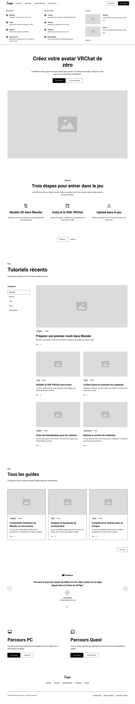

# Dossier de Conception — Mission 4

Ce document présente la structure, les maquettes, les parcours utilisateurs et les choix ergonomiques du projet de guide d'avatars VRChat.

## 1. Arborescence du site
Le site est conçu sous la forme d'une **page unique (Landing Page / Monopage)** optimisée pour la consultation du guide d'avatars VRChat :

- **` / ` (Page d'accueil principale)**
  - **Mega-Menu / Navigation supérieure :** Accès direct aux catégories (Blender, Unity, VRCSDK, etc.) et barre de recherche.
  - **Section En-tête (Hero Banner) :** Titre *« Créez votre avatar VRChat de zéro »*, sous-titre explicatif et boutons d'appel à l'action.
  - **Section 3 Étapes clés :** Synthèse du processus (*Modèle 3D dans Blender*, *Unity et le SDK VRChat*, *Upload dans le jeu*).
  - **Section Tutoriels récents :** Liste dynamique avec filtres par catégorie (Blender, Unity, Quest, Optimisation) et cartes de tutoriels.
  - **Section Tous les guides :** Grille des guides complets avec vignettes et résumés.
  - **Section Témoignage / Avis :** Retour d'expérience d'un utilisateur de la plateforme.
  - **Section Parcours dédiés :** Accès ciblé selon la plateforme (*Parcours PC* vs *Parcours Quest*).
  - **Pied de page (Footer) :** Navigation secondaire et mentions légales.

## 2. Maquettes (Figma)
*Exportations des maquettes wireframe de la page d'accueil.*

### Maquette 1 : Page d'accueil (Vue Desktop)

### Maquette 2 : Page d'accueil (Vue Mobile)

## 3. Parcours Utilisateur (User Flow)
1. **Arrivée** sur la page d'accueil et lecture de la proposition de valeur (*Créez votre avatar VRChat de zéro*).
2. **Orientation** rapide via la section des 3 étapes clés ou le menu de catégories.
3. **Exploration & Filtrage** des tutoriels récents par logiciel/besoin (Blender, Unity, Quest).
4. **Sélection d'un parcours spécifique** (ex: Parcours PC ou Quest en bas de page) pour entamer la création d'avatar.